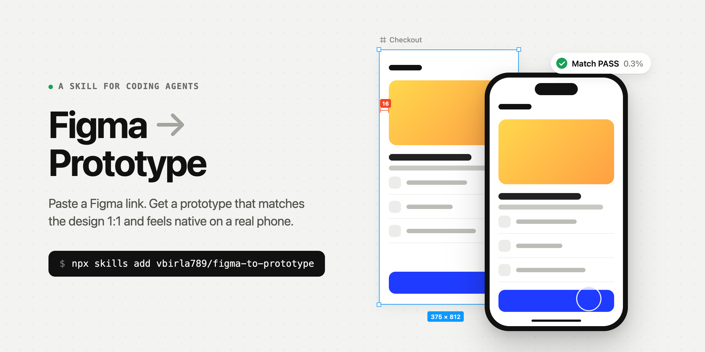

<a href="https://github.com/vbirla789/figma-to-prototype">

</a>

# Figma → Prototype

[](https://skills.sh/vbirla789/figma-to-prototype)

Skills for designers who ship prototypes from Figma.

Every designer now hands Claude a Figma link and gets a prototype back. It reads about 85% of the
design. The other 15% is a padding that's 4px off, a divider that came out 2px thick, a
line-height that pushes every row down, a font that silently fell back. It also looks wrong the
moment someone opens it on a phone. Nobody catches that 15% by eye.

These skills **measure** it, fix it, and make the result behave like a real app on a real phone.

## Install

```bash
npx skills@latest add vbirla789/figma-to-prototype
```

Add `-g` to install for all your projects. The CLI needs Node.js 22.20+.

You also need the **Figma MCP server** connected to your agent, and **Google Chrome** (the match
loop renders screens in it; `npx playwright install chromium` works too).

## Skills

| Skill | What it does |
|---|---|
| [`figma-to-prototype`](skills/figma-to-prototype/SKILL.md) | Figma link → React prototype. Builds every screen, diffs each one against the Figma export and fixes the drift until it passes, wires prototype links into native-feeling transitions, and makes it full-bleed on a real phone. |

## Use

Paste a link and ask for a prototype:

> Build this as a prototype: https://www.figma.com/design/…?node-id=…

The agent confirms the screen order if the link has several frames, builds, measures and fixes
each screen, and hands you a local link, a link for your phone on the same Wi-Fi, and a
per-screen match report.

## Why it's different

**It measures the last 15%.** Every screen is rendered at the Figma frame's exact size and diffed
against the Figma export. The report says what's off and by how much ("7 regions all 4px lower →
one cause above y=64", "this corner looks different"), with Figma | build | diff crops. The agent
fixes the cause and re-checks until the screen passes, without nudging pixels.

**It's right on a phone.** App flows sit in a phone mockup on a laptop. On a real phone the mockup
disappears: no fake status bar or home indicator, no padding, safe areas respected, browser bars
coloured to match each screen, fluid from 360 to 430 wide.

**It moves like an app.** Prototype links become push / back / modal / fade transitions, overlays
become bottom sheets with drag-to-dismiss, everything tappable has a press state, and motion runs
on springs. Your team has a motion standard? Swap the values in one file.

## Cheatsheet

[fidelity-cheatsheet.md](fidelity-cheatsheet.md): the Figma → CSS translations that cause most
"almost right" builds (auto layout, text, strokes and dividers, effects, phone quirks, motion).
It's useful for reviewing any design-to-code work, with or without the skill.

## License

MIT
